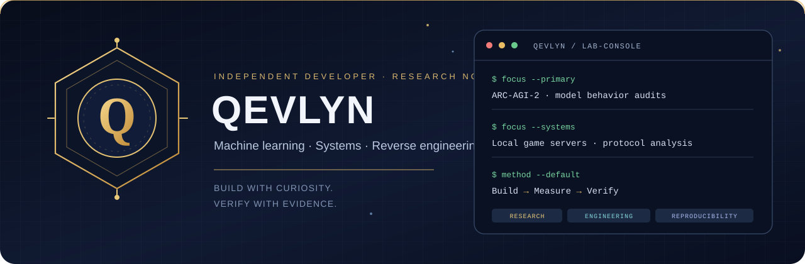

  
    
  
  
  

---

## 01 / About

I explore the space between **machine learning, software systems, and reverse engineering**.

My work is driven by a practical question: *what does a system actually do, and what evidence supports that conclusion?* I enjoy building small experiments, inspecting mechanisms, and documenting both positive and negative results.

- **Machine learning:** ARC-AGI-2 experiments, neural architectures, and behavioral audits.
- **Systems:** local-first software, game-server research, and protocol-level investigation.
- **Engineering approach:** reproducible experiments, explicit claim boundaries, and careful validation.

## 02 / Selected work

<table>
  <tr>
    <td width="50%" valign="top">
      <h3><a href="https://github.com/qevlyn/VRM">VRM — ARC-AGI-2 Research</a></h3>
      Experiments with recurrent direct-grid models and per-task neural compression. Includes controlled tests of support dependence, input-output pairing, target isolation, and unseen-task generalization.
        
      
      
      
    </td>
    <td width="50%" valign="top">
      <h3><a href="https://github.com/qevlyn/InfiniteLoop">InfiniteLoop — Local Game Server</a></h3>
      A local-first, unofficial Punishing: Gray Raven fan project based on AscNet. Focused on running a private server locally, launcher workflows, compatibility, and feature validation.
        
      
      
      
    </td>
  </tr>
  <tr>
    <td width="50%" valign="top">
      <h3><a href="https://github.com/qevlyn/srm-translation-renderers">SRM Translation Renderers</a></h3>
      Audited components for bounded, color-preserving grid translation: a deterministic executor, a differentiable soft surrogate, and a Bayesian MAP verifier.
        
      
      
      
    </td>
    <td width="50%" valign="top">
      <h3>Current direction</h3>
      Investigating how models use evidence, how complex software behaves at runtime, and how to turn observations into repeatable tests.
        
      
      
      
    </td>
  </tr>
</table>

## 03 / GitHub overview

  
  

  Build with curiosity · Measure with care · Report what the evidence supports

